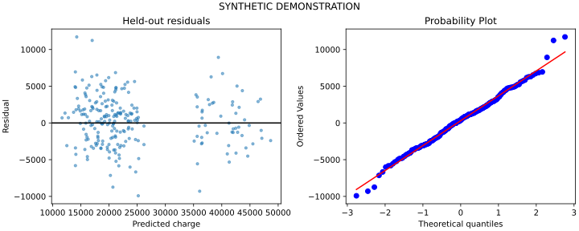

# Insurance Charge Modeling

Multiple-regression workflow with diagnostics and a clearly labeled synthetic demonstration.

## Data and scope

**Synthetic demonstration data.** The original input is unavailable. The CSV in data/ is newly generated using seed 42; it is not reconstructed original data and cannot reproduce the original notebook's historical results.

## Run

```bash
python -m venv .venv
source .venv/bin/activate
python -m pip install -r requirements.txt
python src/analysis.py
python -m unittest discover -s tests -v
```

Outputs are written to `outputs/`. The clean notebook in `notebooks/analysis.ipynb` calls the same tested module. See `docs/provenance.md` for changes from the source notebook and `docs/validation.md` for actual execution results.

Regenerate the clearly labeled demo CSV with `python scripts/generate_demo_data.py`. Supply your own legitimately obtained data using `--input path/to/file.csv`.

## Synthetic demonstration results

On the seeded synthetic CSV: test R² **0.8759**, RMSE **3387.58**, MAE **2659.51**; mean-only baseline RMSE **9674.16**. These measure recovery of an intentionally generated relationship and must not be presented as performance on the missing original dataset.


